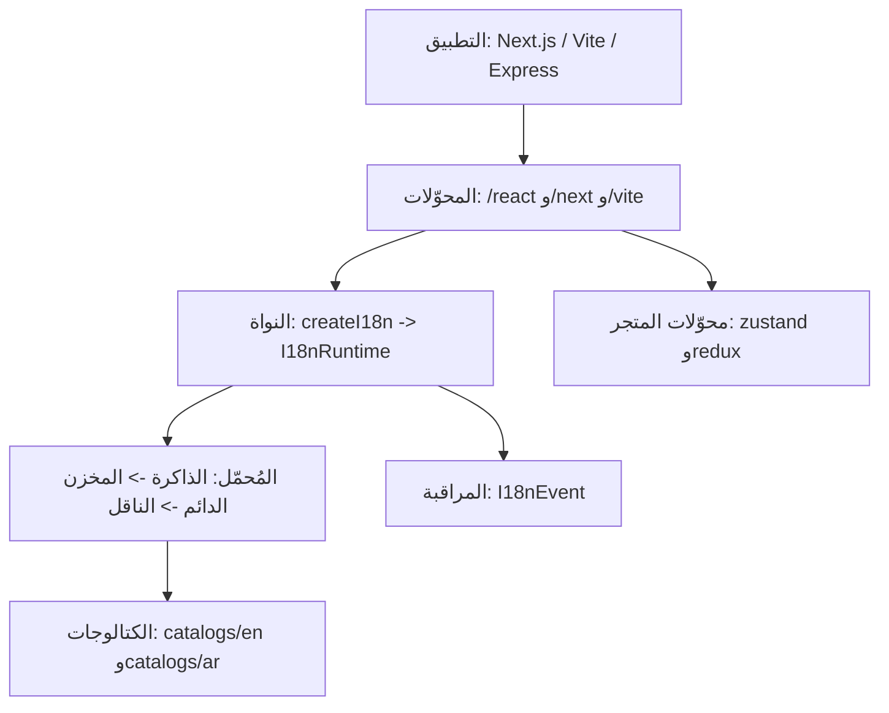
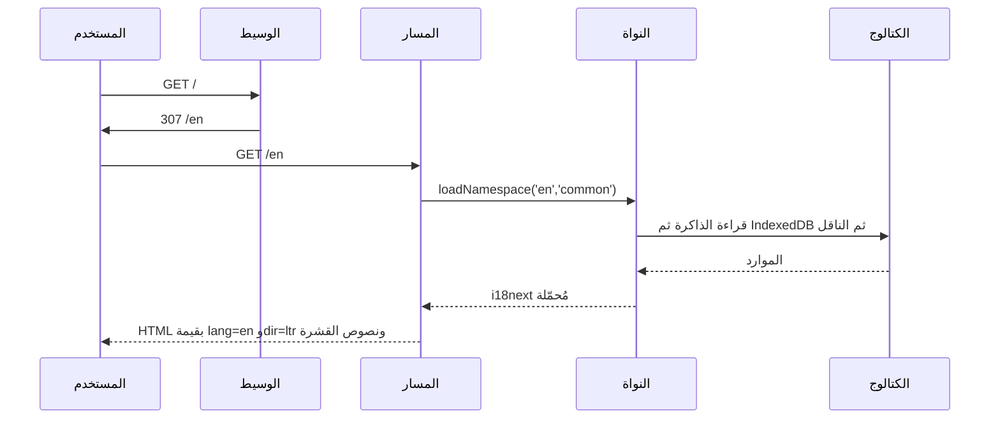

## الطبقات

النواة هي الجوهر الفكري؛ وكل ما عداها منفذ رقيق. تملك النواة نسخة i18next، وتحسم الإعدادات،
وتحمّل مساحات الأسماء عبر مُحمّل متعدد الطبقات. أما المحوّلات فتترجم مفاهيم الإطار (المسارات
والوسيط والخطافات) إلى استدعاءات للنواة.

## الطبقات وملفاتها

| الطبقة | المصدر | المسؤولية |
|---|---|---|
| النواة | `packages/i18n/src/core/*` | حسم الإعدادات وبروتوكول اللغة وكائن التشغيل |
| التخزين المؤقت | `packages/i18n/src/cache/lru.ts` | ذاكرة LRU محدودة تستخدمها طبقة الذاكرة |
| المُحمّل | `packages/i18n/src/loader/*` | الذاكرة والمخزن الدائم (IndexedDB) وإزالة تكرار الطلبات والنقل |
| المراقبة | `packages/i18n/src/obs/events.ts` | إصدار الأحداث دون أن يرمي خطأً أبداً |
| React | `packages/i18n/src/react/*` | المزوّد والخطافات و`Trans` والسياق |
| Next.js | `packages/i18n/src/next/*` | الوسيط ومساعدات الخادم وسمات HTML |
| Vite | `packages/i18n/src/vite/*` | إضافة بيان الكتالوج ومطابقات المسارات |
| المتاجر | `packages/i18n/src/store/*` | مرايا اللغة في Zustand وRedux |
| الهياكل | `packages/i18n/src/stubs/*` | منافذ مكتوبة الأنواع وغير منفّذة لـ native/node/electron |

## دورة حياة الطلب

يحدّد المسار اللغة قبل قراءة أي محتوى. ويحمّل المسار مساحات الأسماء التي يحتاجها فقط، ويحمل أول
بايت من HTML قيمة `lang` و`dir` الصحيحتين مع نصوص القشرة، فلا يوجد وميض.

## قيود التصميم

- لا محرّك تدويل جديد: يبقى i18next هو المحرّك، ويُغلَّف بدل أن يُستبدل.
- صادرات فرعية قابلة لإزالة الشيفرة غير المستخدمة مع `sideEffects: false`؛ فلا تدخل واجهات
  التشغيل غير المستخدمة في أي حزمة.
- الطوبولوجيا حزمة واحدة بمسارات فرعية، لا حزم متعددة.
- كل مساحة أسماء وحدة مستقلة قابلة للتخزين المؤقت ولها ميزانية gzip.

## ذو صلة

- [العرض من الخادم دون وميض](/architecture/zero-flicker)
- [بروتوكول الكتالوج](/architecture/catalog-protocol)
- [نموذج i18next](/architecture/i18next-model)
