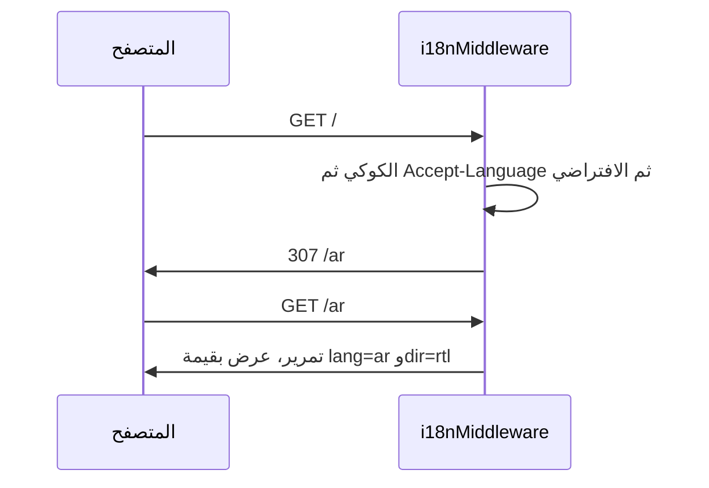

## المشكلة

لوميض التدويل الكلاسيكي ثلاثة أسباب:

1. يعرض الخادم باللغة الافتراضية ثم يعيد العميل الرسم بلغة المستخدم؛
2. يكون الاتجاه (`dir`) مجهولاً حتى تشغيل JavaScript، فتومض الصفحة من اليمين إلى اليسار ثم إلى
   العكس؛
3. تصل النصوص عبر طلب من العميل بعد العرض الأول، فتظهر المفاتيح الخام لبرهة.

## القاعدة

على الويب، **يملك المسار اللغة**. فالمساران `/en/...` و`/ar/...` هما المصدر الوحيد للحقيقة في
ما يُعرض. لا يرسم الكوكي ولا ترويسة `Accept-Language` أي محتوى؛ بل يؤثران فقط في إعادة توجيه
تضع اللغة في المسار.

وهذا يجعل اللغة متاحة قبل أي عرض، على الخادم والعميل معاً.

## العرض الأول

تُرجع `getHtmlAttributes` في `packages/i18n/src/next/html.ts` سمات عنصر المستند:

```tsx
import { getHtmlAttributes } from '@faang/i18n/next'

const { lang, dir } = getHtmlAttributes(lng)

return (
  <html lang={lang} dir={dir}>
    <body>{children}</body>
  </html>
)
```

ولأن `dir` تُضبط على `<html>` في ترميز الخادم، فلا يرتّب المتصفح الصفحة في الاتجاه الخاطئ أبداً.
ومساحات القشرة (`common` و`errors`) أصغر من أن تعطّل الميزانية، فتكون حاضرة في العرض الأول، فلا
تظهر مفاتيح خام.

## لماذا لا نرسم HTML من الكوكي

إغراء رسم أول HTML من الكوكي أنه متاح على الخادم، لكنه مرفوض للأسباب الآتية:

- يصبح الرد معتمداً على الكوكي، فيتعطّل التخزين المؤقت المشترك وشبكات التوصيل؛
- قد يختلف المسار الظاهر عن المحتوى، وهذا مفاجئ وسيئ لمحركات البحث؛
- لا يمكن مشاركة تغيير اللغة عبر الكوكي ولا ربطه ولا وضع علامة مرجعية عليه.

وظيفة الكوكي الوحيدة تذكّر آخر لغة كي يعيد المسار `/` التوجيه إليها.

## مسار إعادة التوجيه



الوسيط منفّذ في `packages/i18n/src/next/middleware.ts`. وهو يعيد التوجيه فقط حين يخلو المسار من
بادئة لغة؛ وبمجرد وجود البادئة لا يفعل شيئاً.

## على العميل

لا يعاود العميل تحديد اللغة. يستقبل `I18nProvider` اللغة من المسار ويعكس
`{ lng, dir, isRtl, status }` إلى السياق، فيعرض React باللغة نفسها التي عرض بها الخادم تماماً.
وتغيير اللغة تنقّل إلى مسار جديد، لا تحوير للحالة.

## ذو صلة

- [بروتوكول الكتالوج](/architecture/catalog-protocol)
- [الوسيط i18nMiddleware](/packages/next/middleware)
- [سمات HTML](/packages/next/html)
