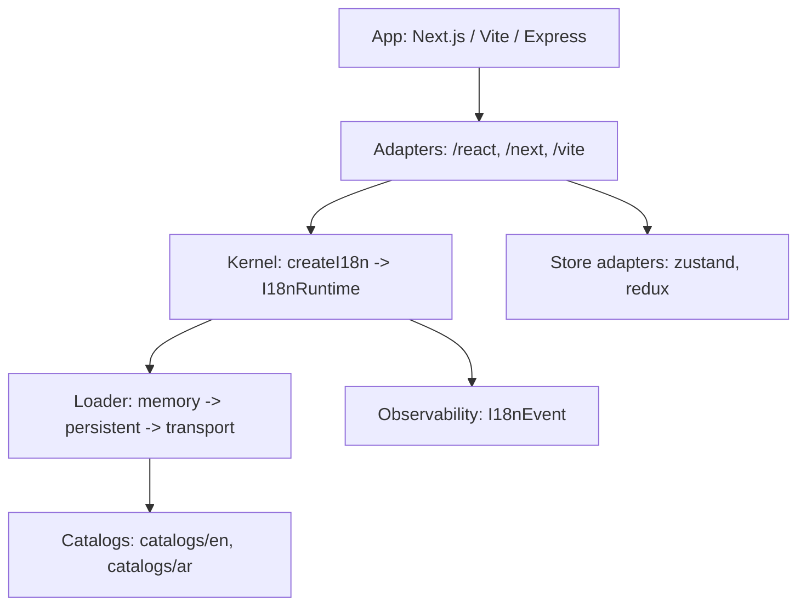
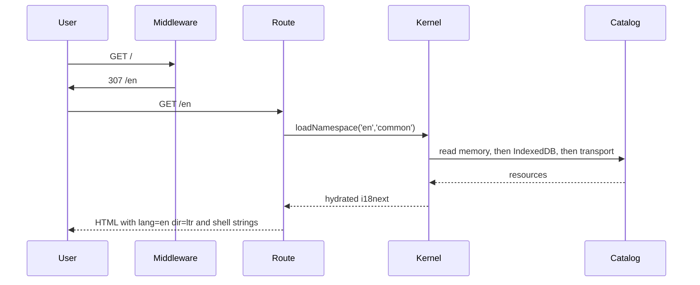

## The Layers

The kernel is the intellectual core; everything else is a thin port. The kernel owns an i18next
instance, resolves configuration, and loads namespaces through a tiered loader. Adapters translate
framework concepts (routes, middleware, hooks) into kernel calls.

## Layers and Their Files

| Layer | Source | Responsibility |
|---|---|---|
| Kernel | `packages/i18n/src/core/*` | config resolution, locale protocol, runtime object |
| Cache | `packages/i18n/src/cache/lru.ts` | a bounded LRU used by the memory tier |
| Loader | `packages/i18n/src/loader/*` | memory, persistent (IndexedDB), in-flight dedupe, transport |
| Observability | `packages/i18n/src/obs/events.ts` | emit events without ever throwing |
| React | `packages/i18n/src/react/*` | provider, hooks, `Trans`, context |
| Next.js | `packages/i18n/src/next/*` | middleware, server helpers, HTML attributes |
| Vite | `packages/i18n/src/vite/*` | catalog manifest plugin, route matchers |
| Stores | `packages/i18n/src/store/*` | Zustand and Redux locale mirrors |
| Stubs | `packages/i18n/src/stubs/*` | typed not-implemented ports for native/node/electron |

## The Request Lifecycle

The URL decides the locale before any content is read. The route loads only the namespaces it
needs, and the first byte of HTML already carries the correct `lang` and `dir` plus the shell
strings, so there is no flash.

## Design Constraints

- No new i18n engine: i18next remains the engine, wrapped rather than replaced.
- Tree-shakeable subpath exports with `sideEffects: false`; unused runtimes never enter a bundle.
- Topology is one package with subpath exports, not many packages.
- Every namespace is a separately cacheable unit with a gzip budget.

## Related

- [Zero-Flicker SSR](/architecture/zero-flicker)
- [Catalog Protocol](/architecture/catalog-protocol)
- [The i18next Model](/architecture/i18next-model)
