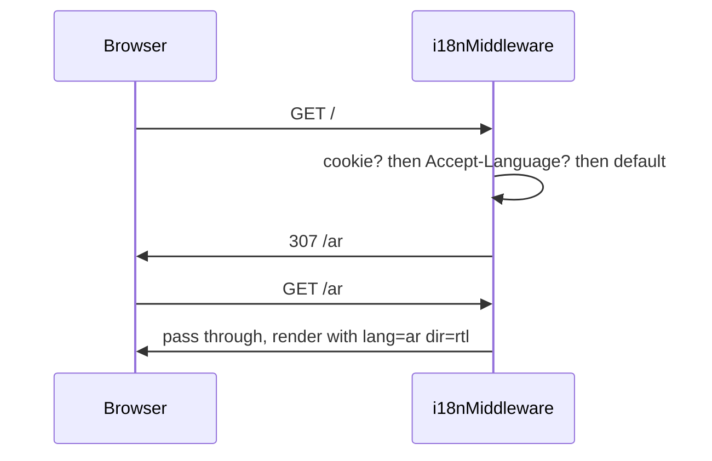

## The Problem

The classic i18n flicker has three causes:

1. the server renders with the default locale and the client repaints with the user's locale;
2. the direction (`dir`) is unknown until JavaScript runs, so a right-to-left page flashes
   left-to-right;
3. the strings arrive from a client fetch after first paint, so raw keys are visible briefly.

## The Rule

On the web, the **URL owns the locale**. `/en/...` and `/ar/...` are the only source of truth for
what is rendered. Cookies and the `Accept-Language` header never paint content; they only influence
a redirect that puts a locale in the URL.

This makes the locale available before any rendering happens, on both the server and the client.

## First Paint

`getHtmlAttributes` in `packages/i18n/src/next/html.ts` returns the attributes for the document
element:

```tsx
import { getHtmlAttributes } from '@faang/i18n/next'

const { lang, dir } = getHtmlAttributes(lng)

return (
  <html lang={lang} dir={dir}>
    <body>{children}</body>
  </html>
)
```

Because `dir` is set on `<html>` in the server-rendered markup, the browser never lays the page out
in the wrong direction. The shell namespaces (`common`, `errors`) are small enough to be present in
the very first render, so no raw keys are shown.

## Why Not Cookie-Painted HTML

Painting the first HTML from a cookie is tempting because the cookie is available on the server.
It is rejected because:

- the response becomes cookie-dependent, which breaks shared caching and CDNs;
- the visible URL and the content can disagree, which is surprising and bad for SEO;
- a locale change via cookie cannot be linked, shared, or bookmarked.

The cookie's only job is to remember the last locale so that `/` can redirect to it.

## Redirect Flow



The middleware is implemented in `packages/i18n/src/next/middleware.ts`. It only redirects when the
path has no locale prefix; once the prefix exists it does nothing.

## On the Client

The client never re-resolves the locale. `I18nProvider` receives the locale from the URL and mirrors
`{ lng, dir, isRtl, status }` into context, so React renders with exactly the same locale as the
server. A locale switch is a navigation to a new URL, not a state mutation.

## Related

- [Catalog Protocol](/architecture/catalog-protocol)
- [i18nMiddleware](/packages/next/middleware)
- [getHtmlAttributes](/packages/next/html)
